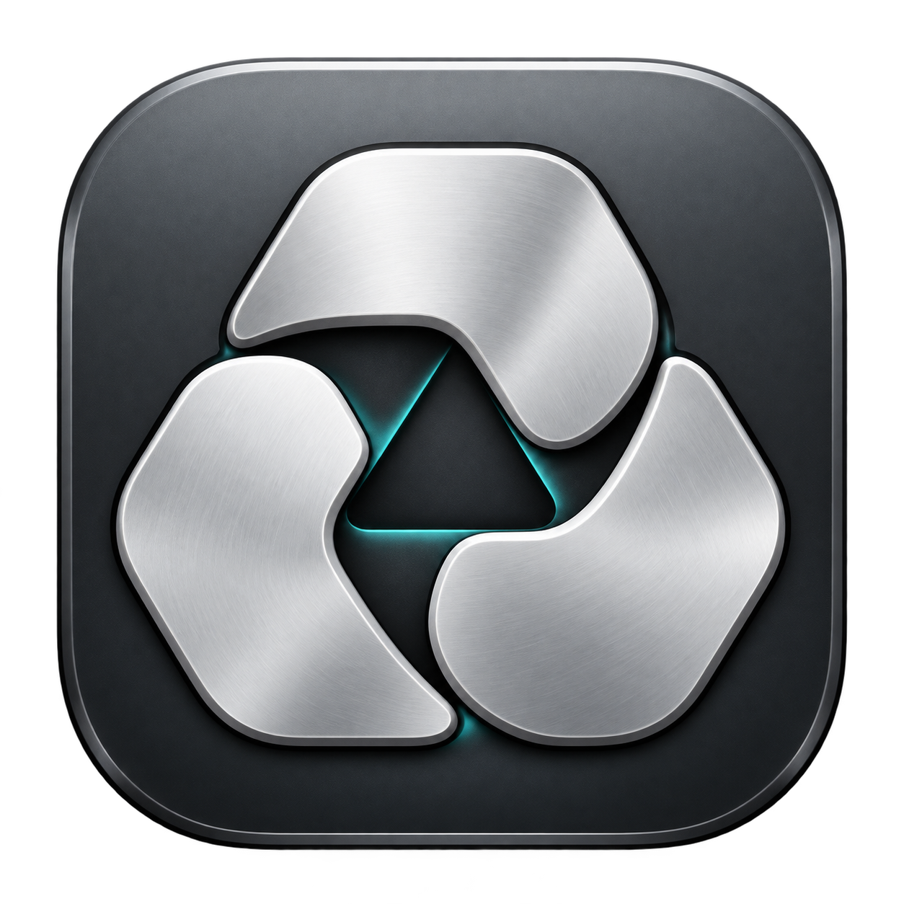
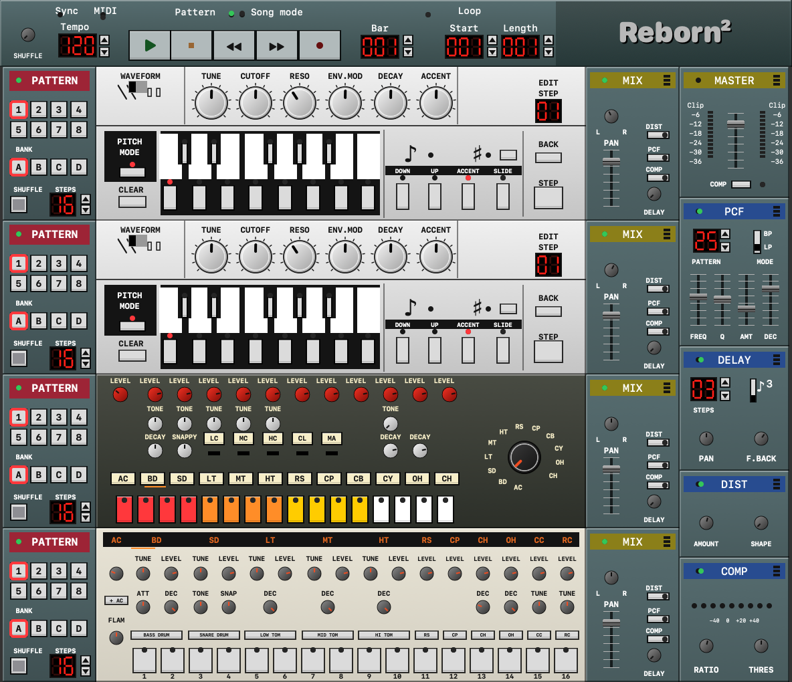

# Reborn²



Native macOS-Sequencer nach dem Vorbild von ReBirth, mit zwei Basssynthesizern, zwei Drum-Maschinen und kompakter Rack-Oberfläche.

**Apple Silicon · macOS 13+ · Swift / C++ · MIT**

Früher Entwicklungsstand mit eigener Klangerzeugung und in Code gezeichneter Oberfläche. Alle eingebauten Drum-Klänge und Filterpatterns werden vom Projekt erzeugt. Originalprogramme, Samples, Songs, Skins und extrahierte Klangtabellen sind nicht enthalten. Samplegenaue Gleichheit mit dem Original wird nicht behauptet.

[English](README.md) · [Fehler melden](https://github.com/derpaile/reborn-squared/issues)



## Funktionen

| Bereich | Umfang |
| --- | --- |
| Basssynthesizer | Zwei 303-inspirierte Stimmen: Sägezahn/Rechteck, Tune, Cutoff, Resonanz, Env Mod, Decay, Accent und Slide. Optionales zweifaches Oversampling. |
| Drums | 808- und 909-inspirierte Kits mit je elf Stimmen, passenden Tune-/Decay-Reglern, Akzenten, kräftigen Anschlägen und Flam. |
| Sequencer | 32 Patterns pro Gerät, Bänke A–D, 1–16 Schritte, Shuffle, Kopieren/Einfügen/Leeren und Wechsel am Taktanfang. |
| Effekte und Mixer | Distortion, Delay, Kompressor und Patternfilter mit 55 erzeugten Mustern; Pegel, Panorama und Sends. |
| Song-Editor | Vier Patternspuren, Takte einfügen/duplizieren/entfernen, Taktsprünge, Automation und MIDI-Noten bearbeiten. |
| Presets | Bassklänge, Drumkits, Effekte, Bass-/Drum-Patterns und ganze Racks; Suche, Speichern, Umbenennen, Löschen und JSON-Import/-Export. |
| MIDI | Live-Spiel, CC-Steuerung, dauerhaftes MIDI-Learn, externe Clock mit 24 Pulsen je Viertelnote und Transport/SPP. |
| Aufnahme und Dateien | Noten, Regler und Patternwechsel aufnehmen; Rückgängig/Wiederholen; native JSON-Sessions, RBS-Kompatibilität und Stereo-WAV. |

Die 46 Drum-Sampleplätze werden beim Start aus Oszillatoren, Hüllkurven und reproduzierbarem Rauschen im Speicher erzeugt. Externe Soundbibliotheken sind nicht nötig.

## Bauen und starten

Voraussetzung: Apple-Silicon-Mac mit macOS 13 oder neuer und Apple Command Line Tools.

```sh
xcode-select --install  # falls die Command Line Tools noch fehlen

git clone https://github.com/derpaile/reborn-squared.git
cd reborn-squared
bash Reborn/build-app.sh
open "Reborn/dist/Reborn².app"
```

Das Skript baut und prüft die App, erzeugt das macOS-Icon in 16–1024 Pixeln, verpackt sie in `Reborn/dist/` und signiert sie lokal. Die App ist nicht notarisiert. Die fertige App läuft offline und benötigt keine Entwicklerwerkzeuge.

Der [macOS-Bau auf GitHub](https://github.com/derpaile/reborn-squared/actions/workflows/build.yml) führt dieselben Prüfungen aus und stellt die verpackte App als Bauartefakt bereit.

## Bedienung

| Aktion | Eingabe |
| --- | --- |
| Start/Stopp | Leertaste |
| Regler/Fader | Ziehen, Mausrad oder Pfeiltasten |
| Feineinstellung | Umschalt halten |
| Ausgangswert | Doppelklick auf den Regler |
| Tempo, Loop oder Bass-Schritt eingeben | Doppelklick auf die Zahl |
| Rückgängig/Wiederholen | ⌘Z / ⌘⇧Z |
| Song-Editor | ⌘E |
| Presets | ⌘⇧P oder Rechtsklick im Patternbereich |
| Zoom | Ansicht, 100–200 %, durch den Bildschirm begrenzt |

Das Rack hält die logischen 592 × 510 Proportionen. Flächen werden mit vierfacher Auflösung zwischengespeichert; Regler und Anzeigen aktualisieren sich separat. Die Fenstergröße berücksichtigt die Titelleiste.

## Sessions, Presets und Soundpacks

Native JSON-Sessions behalten alle Einstellungen, aufgezeichnete MIDI-Noten und eigene eingebettete Soundpacks. Die Preset-Bibliothek liegt unter:

```text
~/Library/Application Support/RebornSquared/Presets/library.json
```

Vorhandene Presets aus Rebirth Reborn werden beim ersten Start übernommen; die bisherige Bibliothek bleibt erhalten. MIDI-Zuweisungen und Fenstereinstellungen bleiben erhalten.

Werk-Presets sind geschützt; zum Bearbeiten eine Kopie sichern. Bass-Presets können beide Bassstimmen bedienen, Drumkits unterscheiden die beiden Drum-Maschinen. Die Samplebank eines Soundpacks gilt für das ganze Rack.

Eigene `.rbrpack`-Dateien können AIFF-Samples und optionale JPEG-/PNG-Skins enthalten. Fehlende Stimmen verwenden die erzeugten Standardklänge. Das Format ist [hier dokumentiert](docs/soundpacks.md).

RBS-Lesen/-Schreiben dient der Dateiformat-Kompatibilität. RBS enthält weder die Remake-Klangerzeugung noch die Samples und unterstützt die native MIDI-Notenspur nicht. Entsprechende Sicherungen werden abgelehnt, um Datenverlust zu verhindern. Originale verschlüsselte RBM-Pakete werden in der öffentlichen Version nicht unterstützt.

## MIDI

Unter **MIDI → Clock und MIDI-Learn** einschalten.

- Bass auf Kanal **1/2**, Drums auf **10/11** mit GM-artiger Notenzuordnung.
- Bass-CCs **20–25**: Tune/Cutoff/Resonanz/Env Mod/Decay/Accent; **26**: Wellenform, **7**: Pegel, **10**: Panorama.
- Für MIDI-Learn einen Zielregler oder den zuletzt bewegten Regler wählen, „Lernen“ drücken und einen CC senden. Zuordnungen bleiben lokal gespeichert.
- Externe Clock übernimmt **24 Pulse je Viertelnote**, Quellenwahl, Start/Continue/Stop und Song Position Pointer.
- Aufnahme erfasst Noten, Regler und Patternwechsel. Stopp beendet gehaltene Noten und erzeugt einen gemeinsamen Schritt für Rückgängig.

Samplegenaue Synchronisation zu einem externen Host ist nicht garantiert.

## Export und Prüfungen

WAV-Export rendert den aktuellen Loop oder den vollständigen Song samt Effektnachlauf als Stereo-Float32 mit 44,1 kHz. Der Vergleich zweier passender Stereodateien richtet sie innerhalb von ±2048 Samples aus und zeigt Abweichung, Korrelation und Länge.

Beim Bau werden die erzeugten Samples, alle 22 Drum-Stimmen, Bassregler und Oversampling, reproduzierbares und begrenztes Audio, MIDI/Clock, Presets/Historie, JSON-/RBS-/Soundpack-Rundläufe, WAV-Export und alle 55 Filterpatterns in beiden Modi an den Reglergrenzen geprüft.

Zusätzliche App-Prüfläufe einzeln starten:

```sh
"Reborn/dist/Reborn².app/Contents/MacOS/Reborn" --feature-check
"Reborn/dist/Reborn².app/Contents/MacOS/Reborn" --ui-check
```

Die Testinstanz beendet sich anschließend. Die Fensterprüfung erzeugt außerdem `/tmp/reborn-squared-ui-check.png`.

## Mitarbeit und Lizenz

Hinweise für Beiträge und Fehlerberichte: [CONTRIBUTING.md](CONTRIBUTING.md).

Code und Projektgrafiken: [MIT](LICENSE). Das neue [App-Icon samt Prompt](docs/icon.md) ist dokumentiert. Importierte Klänge und Skins behalten ihre eigenen Lizenzen. Inoffizielles Projekt ohne Verbindung zu den Herstellern von ReBirth, TB-303, TR-808 oder TR-909.
