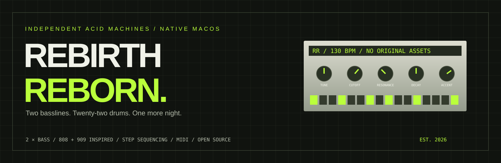

<p align="center"></p>

# Rebirth Reborn

**Eine kleine Acid-Maschine für lange Nächte.** Native App für Apple Silicon, macOS 13+, Swift und C++. [Projektwebsite](https://derpaile.github.io/rebirth-reborn/) · [English](README.md)

Zwei Basslines, zwei Drum-Maschinen, ein kompakter Step-Sequencer: Rebirth Reborn greift den klassischen Rack-Workflow auf und zeichnet ihn für moderne Displays neu. Der Moment bleibt derselbe — wenige Noten, ein beharrlicher Kick und die Resonanz genau einen Tick zu weit aufgedreht.

Dieses Repository enthält ausschließlich das eigenständige Remake. Alle mitgelieferten Klänge, Filterkurven, Filterpatterns und Grafiken werden hier selbst erzeugt oder gezeichnet. Original-Installer, Programme, Aufnahmen, Songs, Mods, Grafiken, ROM-Dumps, übernommene Dekompilierungen und extrahierte Klangtabellen sind ausgeschlossen. Das Originalprogramm wird zum Bauen und Spielen nicht benötigt. Die öffentliche Klangerzeugung ist eine eigene Interpretation; samplegenaue Gleichheit mit dem Original wird nicht behauptet.


## Das Rack

- **Zwei 303-inspirierte Bassstimmen:** Sägezahn/Rechteck, Tune, Cutoff, Resonanz, Env Mod, Decay, Accent und Slide; optionales zweifaches Oversampling.
- **808- und 909-inspirierte Drums:** je elf Stimmen, Akzente, kräftige Anschläge, Flam und passende Klangregler. Alle 46 Sampleplätze werden aus eigener Synthese und reproduzierbarem Rauschen erzeugt.
- **Patterns:** 32 pro Gerät, Bänke A–D, 1–16 Schritte, Shuffle, Kopieren/Einfügen/Leeren und Wechsel am Taktanfang.
- **Effekte:** Distortion, Delay, Kompressor und Patternfilter mit 55 neu erzeugten Rhythmus- und Bewegungsmustern.
- **Song-Editor:** vier Patternspuren, Takte einfügen/duplizieren/entfernen, Taktsprünge sowie Automation und MIDI-Noten bearbeiten.
- **Presets:** Bassklang, Drumkit, Effekte, Bass-/Drum-Pattern und komplettes Rack; Suche, Speichern, Umbenennen, Löschen und JSON-Import/-Export.
- **MIDI:** Live-Spiel, CC-Steuerung, dauerhaftes MIDI-Learn, externe Clock mit 24 Pulsen pro Viertelnote und Transport/SPP.
- **Aufnahme:** Noten, Reglerbewegungen und Patternwechsel. Eine Aufnahme ist ein gemeinsamer Schritt für Rückgängig/Wiederholen.
- **WAV:** aktueller Loop oder ganzer Song einschließlich Effektnachlauf, Stereo/44,1 kHz/Float32.

## Bauen und starten

Voraussetzung: Apple-Silicon-Mac mit macOS 13 oder neuer und Apple Command Line Tools. Zusätzliche Samplepakete oder Paketmanager sind nicht nötig.

```sh
xcode-select --install  # falls die Command Line Tools noch fehlen

git clone https://github.com/derpaile/rebirth-reborn.git
cd rebirth-reborn
bash RebirthReborn/build-app.sh
open "RebirthReborn/dist/Rebirth Reborn.app"
```

Das Skript baut, prüft und verpackt die App in `RebirthReborn/dist/` und signiert sie lokal. Es handelt sich um einen Entwicklungsstand mit lokaler Signatur, nicht um eine notarierte kommerzielle Distribution. Die fertige App braucht zum Spielen weder Entwicklerwerkzeuge noch Internet.

## Der erste Loop

Leertaste drücken, Basspattern in Bank A wählen und wenige Noten setzen. Cutoff langsam öffnen, Resonanz und Env Mod dazugeben. Accent betont einzelne Noten; Slide verbindet sie. Kick auf 1, 5, 9 und 13, Hats dazwischen. Ein wenig Delay-Send auf die Bassline; Distortion, wenn sie Zähne zeigen soll. Dann den Klang als Preset sichern oder Patterns im Song-Editor arrangieren.

Die Website enthält eine kleine, separat erzeugte Web-Audio-Acid-Skizze. Das vollständige Instrument ist die native App.

## Bedienung

| Aktion | Bedienung |
| --- | --- |
| Start/Stopp | Leertaste |
| Regler/Fader | Ziehen, Mausrad oder Pfeiltasten |
| Feineinstellung | Umschalt halten |
| Ausgangswert | Doppelklick auf den Regler |
| Tempo, Loop und Bass-Schritt eingeben | Doppelklick auf die Zahl |
| Rückgängig/Wiederholen | ⌘Z / ⌘⇧Z |
| Song-Editor | ⌘E |
| Presets | ⌘⇧P oder Rechtsklick im Patternbereich |
| Zoom | Ansicht, 100–200 %, durch den Bildschirm begrenzt |

Das Rack hält die logischen 592 × 510 Originalproportionen. Breite und Höhe skalieren gemeinsam; die Titelleiste wird getrennt berechnet. Vierfach aufgelöste Flächen werden wiederverwendet. Im Stopp zeichnet die App nicht ständig neu.

## Dateien und Presets

Native JSON-Sessions speichern alle Erweiterungen, aufgezeichnete MIDI-Noten und eigene eingebettete Soundpacks. Eigene Presets bleiben unter `~/Library/Application Support/Rebirth Reborn Community/Presets/library.json` erhalten. Werk-Presets sind geschützt; eigene Kopien lassen sich bearbeiten.

Drumkits unterscheiden die beiden Geräte. Die Samplebank eines Soundpacks gilt rackweit und beeinflusst damit beide Drum-Maschinen. Das offene `.rbrpack`-Format ist [hier beschrieben](docs/soundpacks.md). Originale verschlüsselte RBM-Dateien werden in dieser öffentlichen Version nicht unterstützt.

RBS-Lesen/-Schreiben bleibt als Dateiformat-Kompatibilität erhalten. RBS transportiert weder die Remake-Klangerzeugung noch die erzeugten Samples und kann die native MIDI-Notenspur nicht speichern. Die App lehnt entsprechende Sicherungen ab, statt Daten still zu verlieren. Original-Songs sind nicht enthalten.

## MIDI

Unter **MIDI → Clock und MIDI-Learn** einschalten. Bass auf Kanal 1/2, Drums auf 10/11. Die Bass-CCs 20–25 bedienen Tune/Cutoff/Resonanz/Env Mod/Decay/Accent; 26 die Welle, 7 den Pegel und 10 das Panorama. Zum Lernen einen Zielregler oder den zuletzt bewegten Regler wählen, „Lernen“ drücken und einen CC senden. Zuordnungen bleiben lokal gespeichert.

Externe Clock übernimmt 24 Pulse je Viertelnote, Quellenwahl, Start/Continue/Stop und Song Position Pointer. Der rote Aufnahme-Knopf zeichnet MIDI-Noten, Regler und Patternwechsel auf; Stopp beendet noch gehaltene Noten. Samplegenaue Synchronisation zu einem externen Host wird nicht behauptet.

## Prüfungen und Mitarbeit

Der Bau prüft die selbst erzeugten Samples, alle 22 Drum-Stimmen, Bassregler und Oversampling, reproduzierbares und begrenztes Audio, MIDI/Clock, Presets/Historie, eigene JSON-/RBS-/Soundpack-Rundläufe und WAV-Export. Hinzu kommen die 55 eigenen Filterpatterns in beiden Modi und an den Reglergrenzen.

Zusätzliche App-Prüfläufe, jeweils einzeln starten:

```sh
"RebirthReborn/dist/Rebirth Reborn.app/Contents/MacOS/Rebirth" --feature-check
"RebirthReborn/dist/Rebirth Reborn.app/Contents/MacOS/Rebirth" --ui-check
```

Die Läufe beenden ihre Testinstanz automatisch. Die Fensterprüfung erzeugt außerdem `/tmp/rebirth-reborn-ui-check.png`.

Version 0.1 ist ein früher spielbarer Stand. Willkommen sind Verbesserungen an Bass-/Drumsynthese, Bedienung, MIDI-Timing, Barrierefreiheit und kurze, reproduzierbare Fehlerberichte. [CONTRIBUTING.md](CONTRIBUTING.md) erklärt den Einstieg. Bitte keine Originalprogramm-Daten oder fremden Samplebibliotheken beitragen.

Code und eigene Projektgrafiken: [MIT](LICENSE). Importierte Klänge und Skins behalten ihre eigenen Lizenzen. Inoffizielles Community-Projekt ohne Verbindung oder Empfehlung durch die Hersteller der genannten Vorbilder.

**Pattern behalten. Nacht verändern.**
